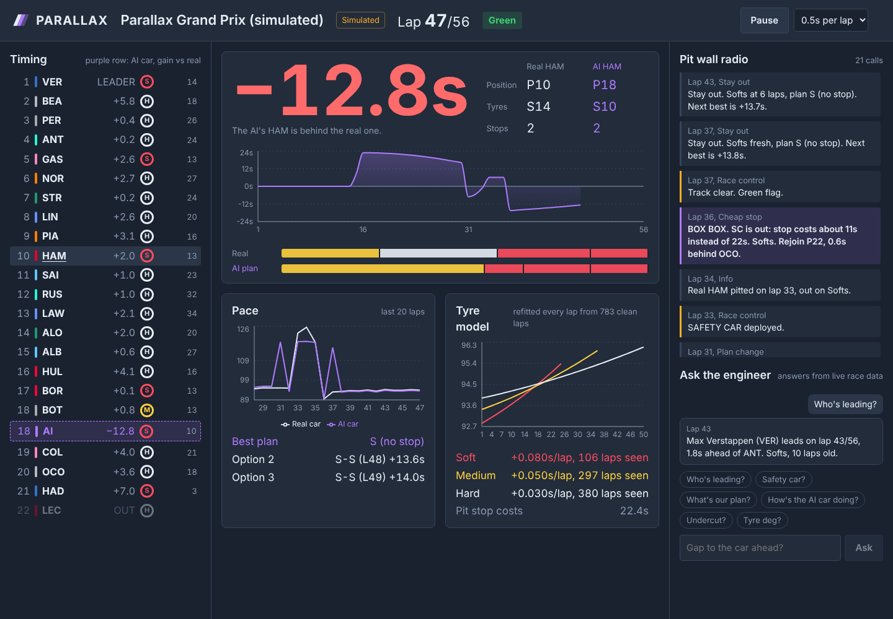
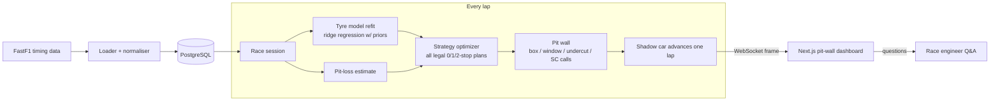

<p align="center"></p>

# Parallax

**An AI pit wall that races its own strategy against the real Formula 1 race.**

Pick a Grand Prix and a driver. Parallax replays the race lap by lap from real FastF1 timing data. Next to the real car it runs a *shadow car*: the same driver in the same race, with the AI making every strategy call live. It only uses what it has seen so far, so it has no hindsight.

You see, in real time:

- **Pit-wall radio calls.** "BOX BOX. Hards. Rejoin P6, 1.4s behind NOR." Also: pit windows, undercut opportunities and threats, and cheap stops under a safety car or VSC.
- **The shadow delta.** How many seconds the AI's strategy has gained or lost against the real one, lap by lap, and where the shadow car would be running in the order.
- **A tyre model that learns during the race.** Degradation per compound is refitted every lap from clean laps only.
- **A race engineer you can question mid-race.** "Who's leading?", "Is there a safety car?", "Gap to VER?", "What's our plan?"
- **What-if mode.** Set your own stops, or let the AI take over from any lap, and see how that call would have played out.



The opening title card: the two purple layers slide out from behind the white one, like parallax layers moving at different speeds.


> Unofficial project, not associated with Formula 1 or the FIA. Timing data comes from the open-source [FastF1](https://github.com/theOehrly/Fast-F1) library.

---

## How it works



### 1. Tyre degradation model (`engine/degradation.py`)

Each clean lap (green flag, no pit in/out lap, no restart lap, no traffic outlier) is modelled as

```
lap_time = intercept[compound] + driver_offset + b[compound]·age + k[compound]·age² + fuel·laps_remaining
```

It is fitted by **ridge regression shrinking towards physical priors**. On lap 3 the model has seen almost nothing, so it falls back to sensible priors. By mid-race the data dominates. A compound nobody has run yet keeps its prior shape and is anchored to the best-observed compound. Driver offsets separate car/driver pace from tyre wear.

On the synthetic test race, where the true parameters are known, the model recovers degradation rates within about 0.006 s/lap.

### 2. Pit-loss estimate (`engine/pitloss.py`)

This is the median, over green-flag stops, of (in-lap + out-lap) minus two typical laps from the same driver around the stop. Under SC and VSC the effective loss is scaled down (×0.5 and ×0.65), which is what makes safety-car stops "cheap".

### 3. Strategy optimizer (`engine/optimizer.py`)

This enumerates every legal 0-, 1- and 2-stop plan for the rest of the race. It respects the two-dry-compounds rule and maximum stint lengths. Stint cost uses closed-form cumulative sums, and the 2-stop search is vectorised with numpy. A full re-plan takes a few milliseconds, so it runs every lap.

### 4. The pit wall (`engine/pitwall.py`)

This turns plans into calls: **BOX** when the best plan stops next lap (with a predicted rejoin position) and **SC_BOX** when neutralisation makes a stop cheap. It also gives pit-window warnings, plan changes (only when the tyre sequence changes or the stop moves by 3+ laps), and an **undercut model**. That model compares two laps on fresh tyres against the rival's old tyres, minus a cold-tyre out-lap penalty, against the gap.

### 5. The shadow race (`engine/shadow.py`)

Each shadow lap starts from the driver's **real** lap time, which carries traffic, driver form and safety-car pace. It then swaps in only the tyre effect of the shadow strategy:

```
shadow_lap = real_clean_lap + [model(shadow tyre) − model(real tyre)] + shadow pit loss
```

So the delta isolates the strategy decision itself. As a sanity check, feeding the shadow car the driver's real strategy reproduces the real result to within a second or two (`test_shadow_with_real_strategy_tracks_reality`).

### Simulated race

The offline race uses the real 2026 grid (11 teams, 22 drivers). The race itself is generated: pace order, strategies, a VSC, a safety car and a retirement are all randomised from a fixed seed, so the results mean nothing about real performance. The app labels it "Simulated" everywhere it appears. Because its tyre physics are known exactly, it doubles as the test fixture.

### 6. Race engineer (`engine/engineer.py`)

A deterministic intent matcher answers questions directly from the live race state: leader, flags, gaps, positions, tyres, plan, undercut, shadow car, stops, fastest lap. Answers are instant and always grounded in data. If `ANTHROPIC_API_KEY` is set, questions it doesn't understand go to an LLM together with the race state as context.

---

## Run it

### With Docker

```bash
docker compose up --build
```

Open http://localhost:3000. Pick **Simulated race** for an instant offline run, or pick a real season and Grand Prix. The first load of a real race downloads timing data and takes about a minute. After that it's cached in PostgreSQL.

### Locally

```bash
# backend (Python 3.11+); uses SQLite if DATABASE_URL isn't set
cd backend
pip install -r requirements.txt
uvicorn app.main:app --reload

# frontend (Node 20+)
cd frontend
npm install
npm run dev
```

### Tests

```bash
cd backend && pytest -q
```

The tests run on a synthetic race with known tyre physics. They check that the model recovers the true degradation and pit loss, that plans follow the regulations, that the shadow car reproduces reality when given the real strategy, and that the engineer answers correctly.

---

## API

| Method | Path | What it does |
|---|---|---|
| `GET` | `/api/schedule/{year}` | Season calendar |
| `POST` | `/api/races/load` | Load a race (`{year, round}` or `{demo: true}`) into PostgreSQL |
| `GET` | `/api/races/{id}/analysis` | Full-race tyre model, pit loss, every driver's real stints, past strategy runs |
| `POST` | `/api/races/{id}/optimize` | Hindsight-optimal plans for a driver from a lap, compared with what they actually did |
| `POST` | `/api/sessions` | Start a live session (`driver`, `mode: auto/fixed`, `stops`, `branch_lap`, `seconds_per_lap`) |
| `WS` | `/ws/sessions/{id}` | Lap frames out; `ask`, `pause`, `resume`, `speed`, `jump` in |
| `POST` | `/api/sessions/{id}/ask` | Ask the engineer over REST |

Interactive docs are at http://localhost:8000/docs.

## Project layout

```
backend/app/
  data/      FastF1 loader, synthetic race, PostgreSQL repository
  engine/    tyre model, pit loss, optimizer, pit wall, shadow race, engineer
  live/      race session (the lap loop) and timing-tower snapshot
  main.py    FastAPI app
frontend/
  app/       setup page and live dashboard (Next.js App Router)
  components timing tower, delta panel, charts, radio feed, engineer chat
```

## Known limitations

These are deliberate scope choices.

- **No car-to-car interaction in the shadow race.** The shadow car doesn't get stuck in traffic or affect other cars. Rejoin positions are estimated from the gaps.
- **Dry strategy only.** On intermediates and wets the model pauses and says so.
- **Fixed fuel effect** (0.032 s per lap of fuel) rather than one fitted per circuit.
- **Safety-car pit savings** use fixed multipliers rather than a measured gap to the SC train.

## Roadmap

- Monte Carlo strategy evaluation (SC probability per lap, pace noise) instead of a single expected-time plan
- Traffic model: time lost when rejoining behind a slower car
- Live sessions from the F1 live-timing feed during a race weekend
- Per-circuit fuel and tyre priors learned from previous seasons
